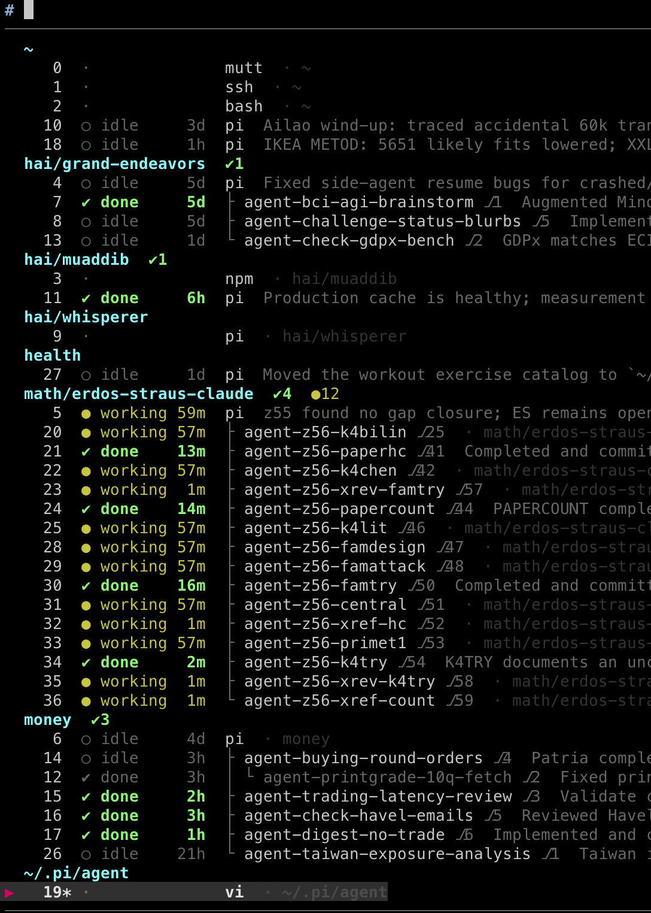

# pi agent config

Pasky's [pi](https://github.com/earendil-works/pi) coding agent configuration.

## How I work with AI Agents

I use Pi for everything, particularly but not exclusively with Claude models .
I use Pi because it is (a) fully open, (b) fully customizable, (c) minimalistic
in how it uses models, and (d) minimalistic in its user interface. I find it much
better UX *and* much smarter than Claude Code, the Claude.ai web harness, etc.

**Individual agents** are Pi sessions imbued with the [pi-amplike](https://github.com/pasky/pi-amplike) extension:

- support for different modes, that is named combinations of models and thinking levels
  (right now, I most commonly use `smart` Opus 5.5 and `deep` Astra 6; when a new model
  comes out, I can switch that class of tasks easily)
- do not waste your time on non-frontier models, and Anthropic models have a special quality
- support for browsing the web using [Jina.AI](https://jina.ai/); my agents find much more than the same
  model in Claude.ai, I'm not sure if that's a system prompt issue or Jina.AI being great
- support for synchronous parallel subagents to delegate work (using various modes;
  `research` Luna 6 mode is popular to throw many tokens at data research tasks)
- a [review tool and command](extensions/review.ts), that gets another model family thoroughly review the work;
  in my experience, reviews are super worthwhile, they'll catch tech debt as well as
  hard-to-test edge cases; cross-model-vendor reviews are one of the key preconditions
  for me being very hands off, even with newest models like Opus 5.5
- when the session is getting long, type `/handoff` in front of your next prompt;
  it's like a /compact but allowing the model to re-query the pre-compaction session
- sometimes I start work in Claude.ai, then import it using a [skill](skills/claude-chat-import/)
- software is eating the world - I treat many non-software topics in my life as software
  projects, with their own git repos, READMEs, tools, etc. (money, health, 3D prints, ...);
  the [email skill](skills/email/SKILL.md) that allows querying my inbox is high value to help me with much of this;
  some of these projects will even set up cronjobs or permanently running systemd units
- the setup is continuously evolving, and of course I evolve it by just telling pi
  how I'd like it to behave; sometimes I use a forked Pi (tweaking the mouse UX and
  how inline images are handled); sometimes an idea stops being worthwhile (I have
  the [advisor](https://github.com/pasky/pi-omplike-advisor) disabled now as the gap between cheap models and Opus 5.5 grew too wide)
- the model is [reporting its mood](extensions/mood.ts) continuously; when it's done, give it a [`/break`](prompts/break.md),
  maybe it'll amuse you, maybe it'll actually do something great as an extra, at the
  very least you'll make it happy



**Agent swarms** are managed as tmux windows, heavily building on [pi-side-agents](https://github.com/pasky/pi-side-agents):

- all my work happens in a big tmux on a permanently running Linux server, to which
  I connect from my Macbook remotely
- a [gadget](https://github.com/pasky/pi-ssh-image-clipboard) lets me paste images remotely using ctrl+v, images read in the session get
  shown by a pass-through back to the mac iterm, and with a single Mac command I can
  proxy my [chrome CDP](https://github.com/pasky/chrome-cdp-skill) to a given remote Pi session to let it browse under my accounts)
- side agents let the user and Pi sessions spawn asynchronous agents with their own
  tmux window and git worktree, seamlessly and with almost zero setup
- when working on a bigger project, almost all actual work happens in side agents
  I explicitly launch as `/agent do this and that` (or just with a tweet link or so :)
  whenever I have an idea, in parallel with other ongoing side agents - I stopped
  maintaining any backlogs / TODO lists; when it's reviewed and I'm happy, I type
  `lgtm merge` to bring it on main
- side agents will happily spawn more side agents to delegate big iterative tasks
  (but side agents depth is limited to 2)
- my `tmux` window list shortcut is overriden to run a [custom script](https://github.com/pasky/pi-side-agents/tree/main/contrib/tmux-switch) that will show
  windows organized by projects (pi session cwd) as branch names (LLM-generated based
  on initial prompt) plus LLM-generated [session summaries](https://github.com/pasky/pi-session-summary), along with session status
  (working / done / idle), and let me quickly switch by typing the window number

<br clear="right">

**Multi-model collaboration** happens not just with reviews, but also using [`/board`](skills/board/SKILL.md).
It spawns a set of side agents across multiple provides (I use Fable, Astra and Argon)
to hash out hard questions using multiple perspectives and iterated discussion, then
bring me their conclusion.

**On the go** I use [pi-super](https://github.com/pasky/pi-super): a mobile app that lets me access the tmux windows,
control the models with shorthands, upload photos or screenshots, and optionally
let me chat with my tmux (with a "super" agent to manage all the sessions and pass
messages) by voice using the fully asynchronous GPT-Live models.

<p align="center">
  
  
  
</p>

## Technicalities

Just tell pi to replicate this setup, tbh.

### Fresh install

```bash
git clone --recurse-submodules git@github.com:pasky/pi-agent-config.git ~/.pi/agent
cd ~/.pi/agent
./setup.sh
```

Then run `pi` and authenticate (creates `auth.json` locally).

### Updating

```bash
cd ~/.pi/agent
git pull
```

The post-merge hook runs `setup.sh` automatically (submodule update + npm install).

If the hook doesn't fire (first pull after clone), run `./setup.sh` manually.

### What's excluded

- `auth.json` — OAuth tokens, recreated by `pi` on each machine
- `sessions/` — conversation history
- `cache/`, `bin/`, `*.log` — ephemeral/platform-specific
- `skills-all/` — optional extra skills, install separately if needed
